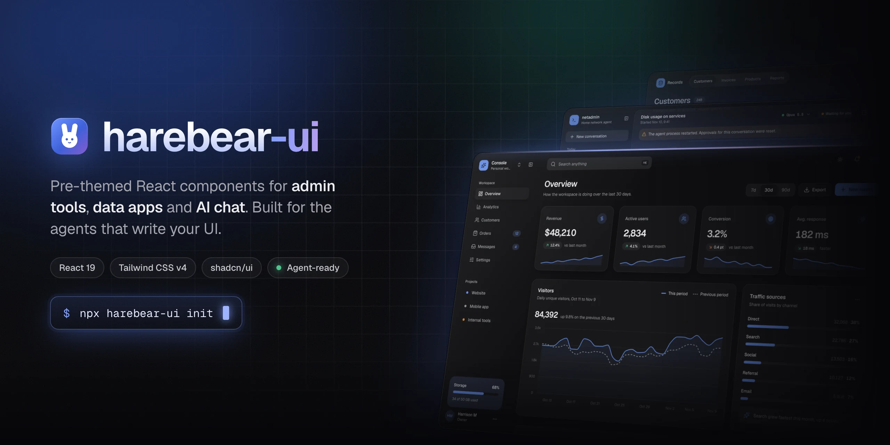
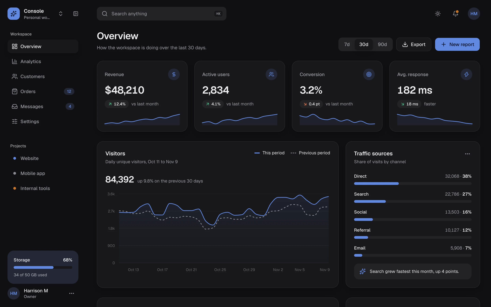
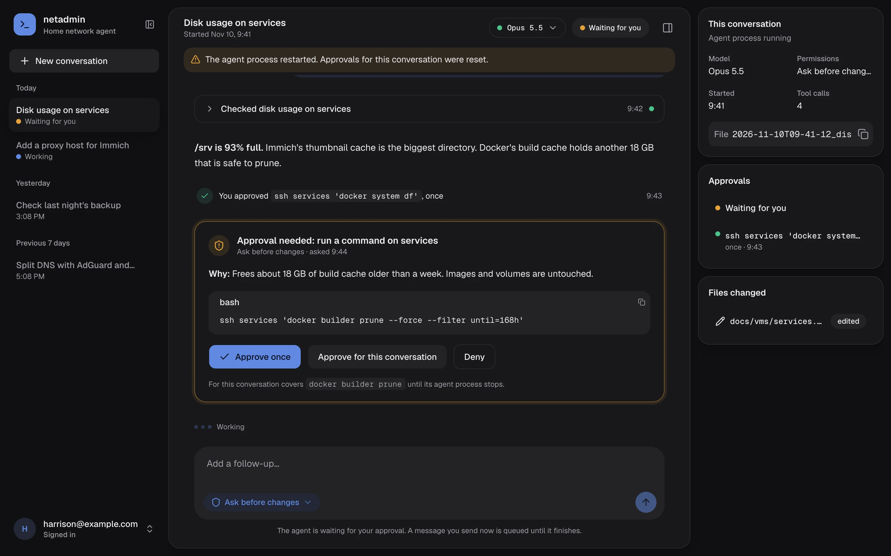
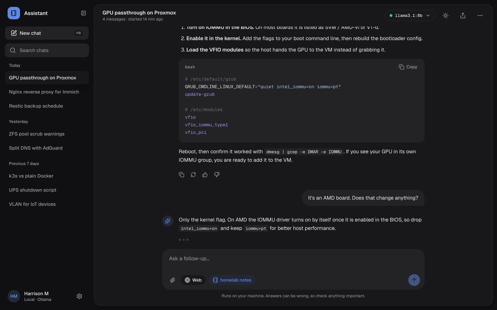
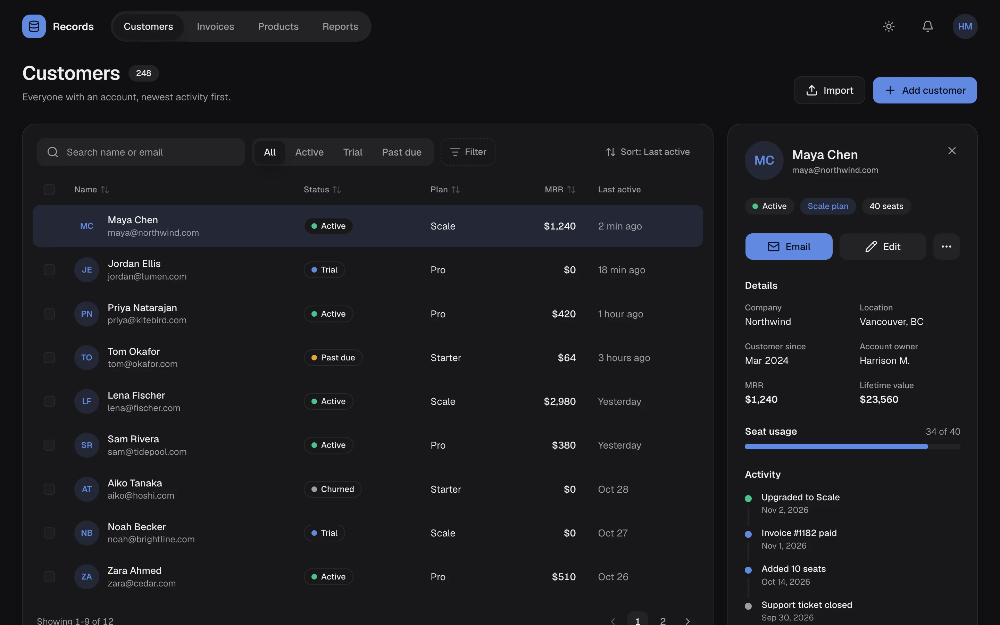
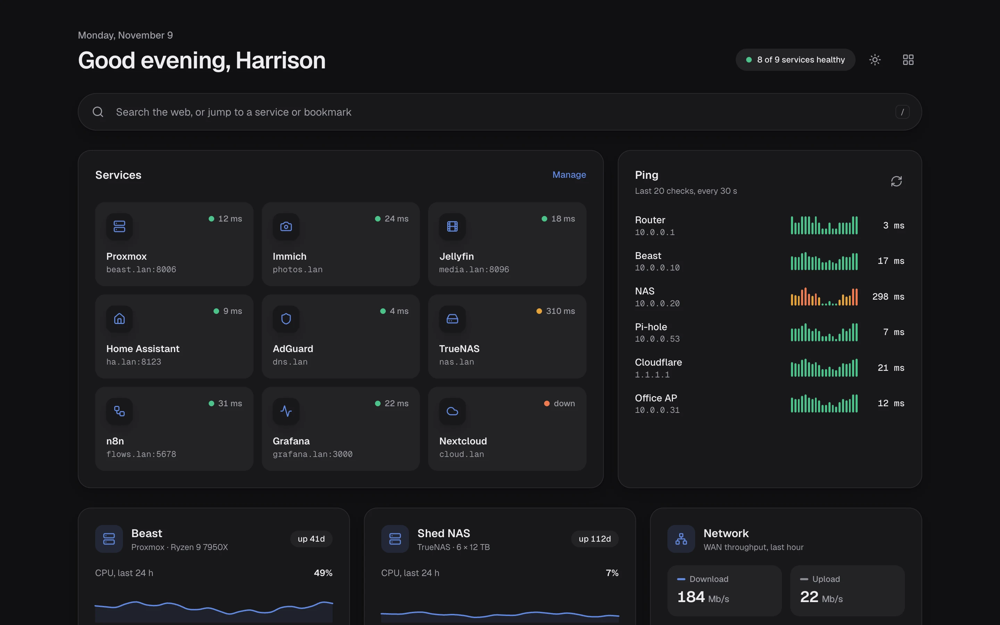
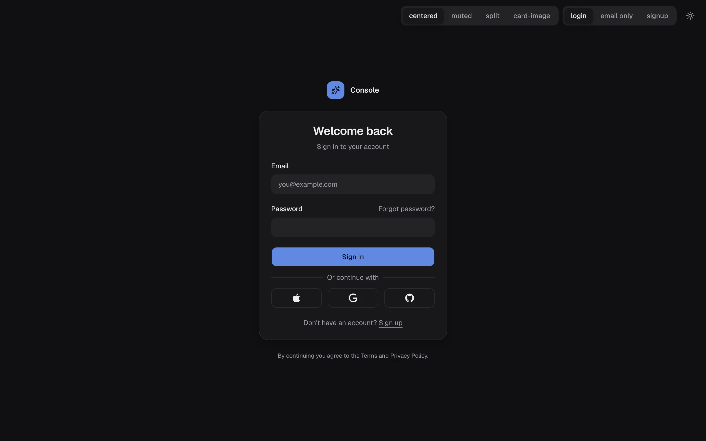
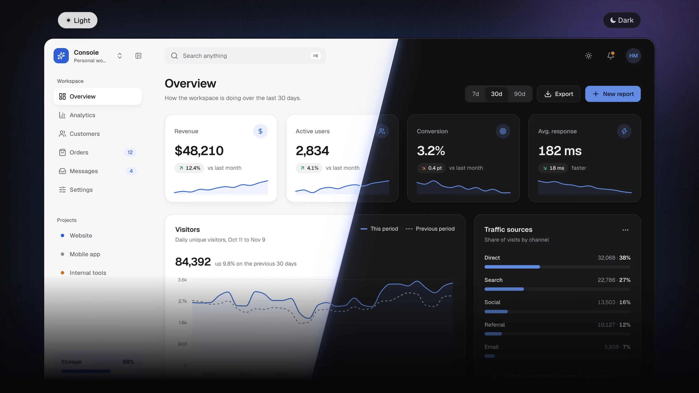
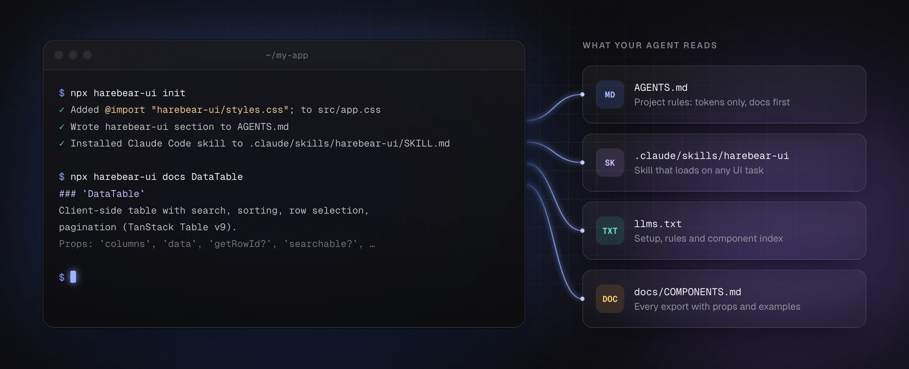

<p align="center">
  
</p>

<h1 align="center">harebear-ui</h1>

<p align="center">
  Pre-themed React components for admin tools, data apps and AI chat.<br />
  shadcn/ui restyled to one design system, plus the composites you build every time. Agent-ready out of the box.
</p>

<p align="center">
  <a href="https://www.npmjs.com/package/harebear-ui"></a>
  <a href="https://github.com/HMilbradt/harebear-ui/actions/workflows/ci.yml"></a>
  
  
  <a href="LICENSE"></a>
</p>

<p align="center">
  
</p>

<p align="center">
  <a href="docs/guides/getting-started.md"><b>Get started</b></a> ·
  <a href="docs/COMPONENTS.md"><b>Components</b></a> ·
  <a href="docs/guides/theming.md"><b>Theming</b></a> ·
  <a href="docs/guides/agents.md"><b>AI agents</b></a> ·
  <a href="playground/screens"><b>Reference screens</b></a>
</p>

## Why

Every internal tool, dashboard and chat app ends up needing the same pieces: an app shell with a collapsible sidebar, KPI cards, a sortable table with a detail panel, trend charts, a chat thread with a composer and tool calls. shadcn/ui gives you primitives to build them. harebear-ui gives you them built, in one consistent look, so you (or your agent) spend the time on the product.

- **Every shadcn/ui primitive**, same names and props, restyled to one set of tokens.
- **Composites on top:** `AppShell`, `StatCard`, `DataTable`, `TrendChart`, `ChatShell`, `PromptInput`, `ToolStep`, `ApprovalCard`, `LoginForm` and more.
- **Light and dark from one accent.** Change the brand color, radius and font with props or CSS variables.
- **Docs agents can use.** `npx harebear-ui init` installs project rules and a Claude Code skill; `npx harebear-ui docs DataTable` prints one component's API.

## Screens

Built only from public exports. Each one is a file in [`playground/screens/`](playground/screens) you can copy from.

<table>
  <tr>
    <td width="50%"><a href="playground/screens/admin.tsx"></a><br /><b>Admin dashboard</b>: <code>AppShell</code>, <code>StatCard</code>, <code>TrendChart</code>, <code>BarList</code></td>
    <td width="50%"><a href="playground/screens/agent.tsx"></a><br /><b>Agent with approvals</b>: <code>ChatShell</code>, <code>ToolGroup</code>, <code>ApprovalCard</code></td>
  </tr>
  <tr>
    <td width="50%"><a href="playground/screens/chat.tsx"></a><br /><b>AI chat</b>: <code>ChatPanel</code>, <code>ChatMessage</code>, <code>CodeSnippet</code>, <code>PromptInput</code></td>
    <td width="50%"><a href="playground/screens/records.tsx"></a><br /><b>Records</b>: <code>DataTable</code>, <code>KeyValueGrid</code>, <code>Timeline</code></td>
  </tr>
  <tr>
    <td width="50%"><a href="playground/screens/home.tsx"></a><br /><b>Status home</b>: <code>LinkTile</code>, <code>StatusBars</code>, <code>Sparkline</code></td>
    <td width="50%"><a href="playground/screens/auth.tsx"></a><br /><b>Auth</b>: <code>AuthLayout</code>, <code>LoginForm</code>, <code>SignupForm</code></td>
  </tr>
</table>

## Quick start

Needs React 19 and Tailwind CSS v4.

```bash
npm i harebear-ui
npx harebear-ui init
```

`init` adds the stylesheet import after `@import "tailwindcss"`, writes a harebear-ui section into `AGENTS.md` (or `CLAUDE.md`), and installs a Claude Code skill. Then wrap your root:

```tsx
import { ThemeProvider, Toaster, TooltipProvider } from "harebear-ui"

export function Root() {
  return (
    <ThemeProvider accent="#2F5BD3" radius={14}>
      <TooltipProvider>
        <App />
        <Toaster />
      </TooltipProvider>
    </ThemeProvider>
  )
}
```

And build:

```tsx
import { AppShell, Button, DataTable, PageHeader, StatCard } from "harebear-ui"
```

Everything imports from the package root. Geist and Geist Mono are bundled.

Step-by-step setup for **Vite**, **Next.js** and **React Router**, plus troubleshooting: [Getting started](docs/guides/getting-started.md).

## Theming



Light, dark and system modes, accent, radius and font are `ThemeProvider` props, changeable live with `useTheme()`. Every component reads shadcn-named tokens, so you can override any of them in CSS:

```css
@import "tailwindcss";
@import "harebear-ui/styles.css";

:root {
  --brand: #0f8a7e;
  --radius: 0.625rem;
}
.dark {
  --background: #0b0b0d;
}
```

SSR apps render `<ThemeScript />` in `<head>` to avoid a flash of the wrong mode. More in [Theming](docs/guides/theming.md).

## Built for AI agents



The package carries its own agent docs, so Claude Code, Codex, Cursor and friends know what exists and how to use it:

| File                          | For                                                                   |
| ----------------------------- | --------------------------------------------------------------------- |
| `llms.txt`                    | Short index: setup, rules, every export by group.                     |
| `docs/COMPONENTS.md`          | Every export with props and examples. Test-enforced to stay complete. |
| `docs/guides/`                | Setup per framework, theming, working with agents.                    |
| `skills/harebear-ui/SKILL.md` | Claude Code skill; `npx harebear-ui init` installs it.                |

Agents look up one component at a time instead of reading the whole catalog:

```bash
npx harebear-ui docs DataTable StatCard   # exports
npx harebear-ui docs Prompt               # prefix: PromptInput, PromptInputChip, PromptInputSelect
npx harebear-ui docs Tokens               # a section
```

Prompts that work, and what to check before you accept an agent's UI: [Working with AI agents](docs/guides/agents.md).

## What's inside

| Group         | Exports                                                                                                                     |
| ------------- | --------------------------------------------------------------------------------------------------------------------------- |
| Layout, admin | `SidebarLayout`, `AppShell`, `PageHeader`, `StatCard`, `StatusBadge`, `UsageMeter`, `Timeline`, `UserMenu`, `ConfirmDialog` |
| Data          | `DataTable`, `TrendChart`, `BarList`, `Sparkline`, `StatusBars`                                                             |
| AI and chat   | `ChatShell`, `ChatPanel`, `ChatMessage`, `PromptInput`, `ModelPicker`, `ToolGroup`, `ApprovalCard`, `CodeSnippet`, `Prose`  |
| Auth          | `AuthLayout`, `LoginForm`, `SignupForm`                                                                                     |
| Primitives    | The full shadcn/ui registry: `Button`, `Dialog`, `Select`, `Sidebar`, `Tabs`, `Command`, `Chart`, and the rest              |

The full list with props: [docs/COMPONENTS.md](docs/COMPONENTS.md).

## Develop

```bash
pnpm install
pnpm dev     # playground on :5199
pnpm check   # lint, typecheck, test, build, package lint
pnpm shots   # regenerate the README images (needs pnpm dev running, Chrome and cwebp)
```

Working on this repo with an agent: see [AGENTS.md](AGENTS.md).

## License

MIT
