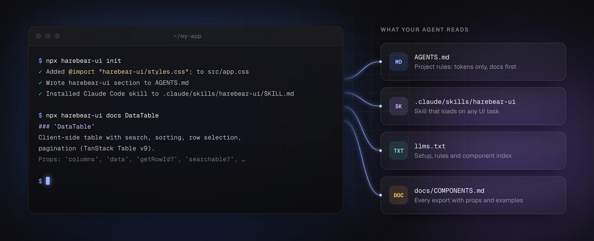

# Working with AI agents

harebear-ui is built to be used by coding agents (Claude Code, Codex, Cursor, Copilot and the like). The package ships its own instructions, so an agent in your repo knows which components exist, how to style them, and how to check its work, without you pasting docs into the prompt.



## What ships in the package

| File (in `node_modules/harebear-ui/`) | What it is                                                                                    |
| ------------------------------------- | --------------------------------------------------------------------------------------------- |
| `llms.txt`                            | Short index: setup, the styling rules, every export by group. Small enough to paste anywhere. |
| `docs/COMPONENTS.md`                  | The catalog: every export with props, variants and examples. A test keeps it complete.        |
| `docs/guides/`                        | These guides: setup per framework, theming, agents.                                           |
| `skills/harebear-ui/SKILL.md`         | A Claude Code skill that loads whenever the agent builds or changes UI.                       |
| `AGENTS.md`                           | Instructions for agents working on harebear-ui itself (not needed in your app).               |

## Set up your repo

```bash
npx harebear-ui init
```

This writes two things your agent reads automatically:

1. **A harebear-ui section in `AGENTS.md`** (or in `CLAUDE.md` if that file exists and `AGENTS.md` does not). It points at the catalog and states the rules: import from the package root, tokens only, check light and dark mode and phone width. The section sits between `<!-- harebear-ui:start -->` and `<!-- harebear-ui:end -->` markers, and running `init` again after an upgrade replaces it in place.
2. **A Claude Code skill** at `.claude/skills/harebear-ui/SKILL.md`. Claude Code loads it on UI tasks; it adds the composition rules (which composite to use for which screen) and the visual checks.

Commit both. Re-run `npx harebear-ui init` after upgrading harebear-ui to refresh them.

### Per tool

| Tool          | What it reads                                                                                                        |
| ------------- | -------------------------------------------------------------------------------------------------------------------- |
| Claude Code   | `CLAUDE.md` and `.claude/skills/`. If your instructions live in `AGENTS.md`, add a line `@AGENTS.md` to `CLAUDE.md`. |
| Codex, Cursor | `AGENTS.md`. See [agents.md](https://agents.md) for the tools that follow the convention.                            |
| Anything else | Point it at `node_modules/harebear-ui/llms.txt` in your own instructions file.                                       |

## Look things up instead of reading everything

The full catalog is long. Agents (and you) can pull just the entries a task needs:

```bash
npx harebear-ui docs DataTable            # one export
npx harebear-ui docs DataTable StatCard   # several
npx harebear-ui docs Prompt               # every export starting with "Prompt"
npx harebear-ui docs Tokens               # a whole section: Theme, Tokens, Auth, "AI and chat", ...
npx harebear-ui docs                      # everything
```

A lookup prints the matching `###` sections, or the primitive's table row with its header. It exits with status 1 when nothing matches, so an agent notices a wrong name instead of guessing.

## Prompts that work well

The instructions already cover style rules, so prompts can stay about the product:

- "Build a settings page with a profile card, a notifications card with switches, and a danger zone with a delete-account ConfirmDialog."
- "Turn `orders.json` into an orders screen: DataTable with status badges, a detail panel when a row is clicked, and a KPI row above it."
- "Make a chat UI for our support bot with a conversation list, tool calls shown as ToolSteps and approval prompts for refunds."
- "Start from the admin reference screen and adapt it to our metrics endpoint."

Pointing at a reference screen is the fastest way to a good result. The playground has six, built only from public exports: [`playground/screens/`](https://github.com/HMilbradt/harebear-ui/tree/main/playground/screens) (admin dashboard, AI chat, agent with approvals, records table with detail panel, status home, auth).

## Review what the agent built

Things to check before you accept a UI change:

- **Both modes.** Toggle light and dark. Anything that only works in one used a palette color instead of a token.
- **Phone width.** At 375px rows wrap, tables scroll inside their card, and the sidebar becomes a sheet.
- **No forks.** The agent imported from `harebear-ui` rather than copying component source into the app.
- **No color overrides.** `className` on harebear components is for layout. A `bg-*` or `text-*` color override on a library component means the agent hit a gap; ask it to report the gap instead.
- **Accessible icons.** Icon-only buttons have an `aria-label`.

## Working on harebear-ui itself

Agents contributing to this repo should read [AGENTS.md](../../AGENTS.md) at the repo root. It covers the layout, the conventions for new components, the checks (`pnpm check`), and how to regenerate the README images (`pnpm shots`).
